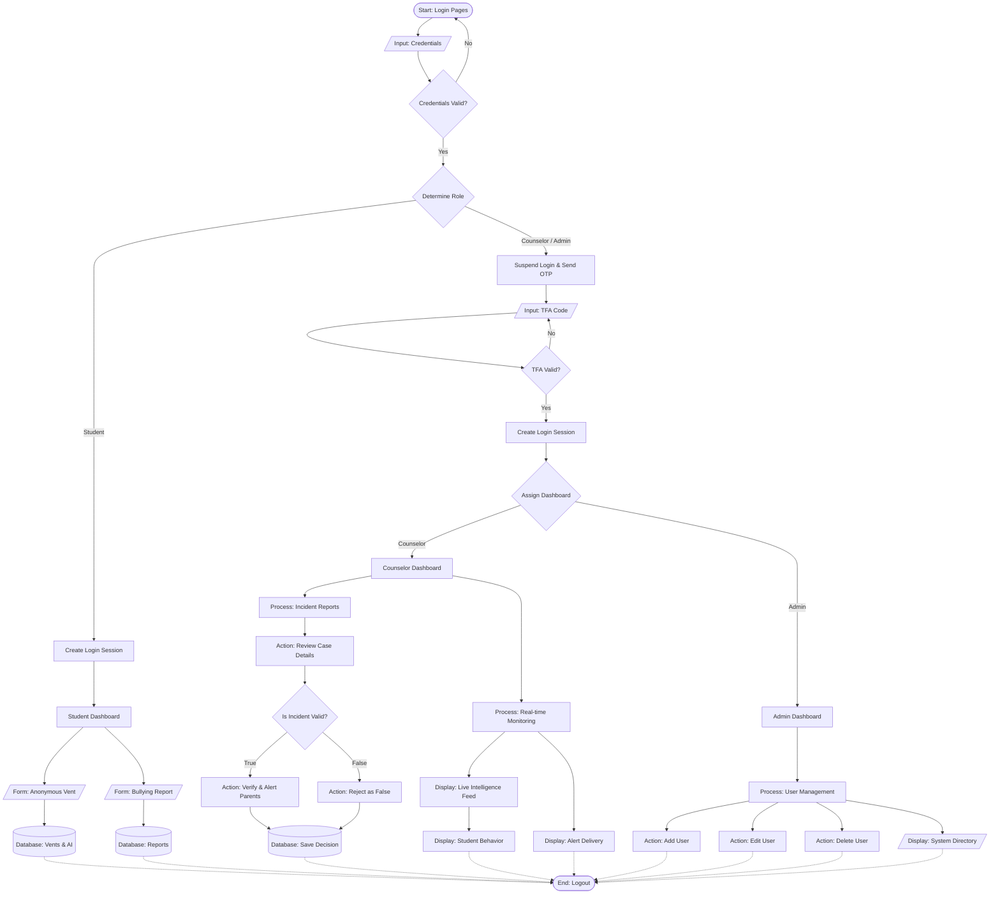

# System Flowchart (By Role)

This flowchart separates the user journeys based on their specific roles (Student, Counselor, and Admin) after the initial login and Two-Factor Authentication (TFA) process.

### How to open this in Draw.io
To get this exact flowchart with native editable shapes in Draw.io:
1. Open [app.diagrams.net](https://app.diagrams.net/).
2. In the top menu, go to **Arrange** > **Insert** > **Advanced** > **Mermaid...**
3. Copy the code from the `mermaid` block above and paste it into the text box.
4. Click **Insert**. Draw.io will automatically read the shapes (databases, decisions, etc.) and lay them out for you perfectly.

